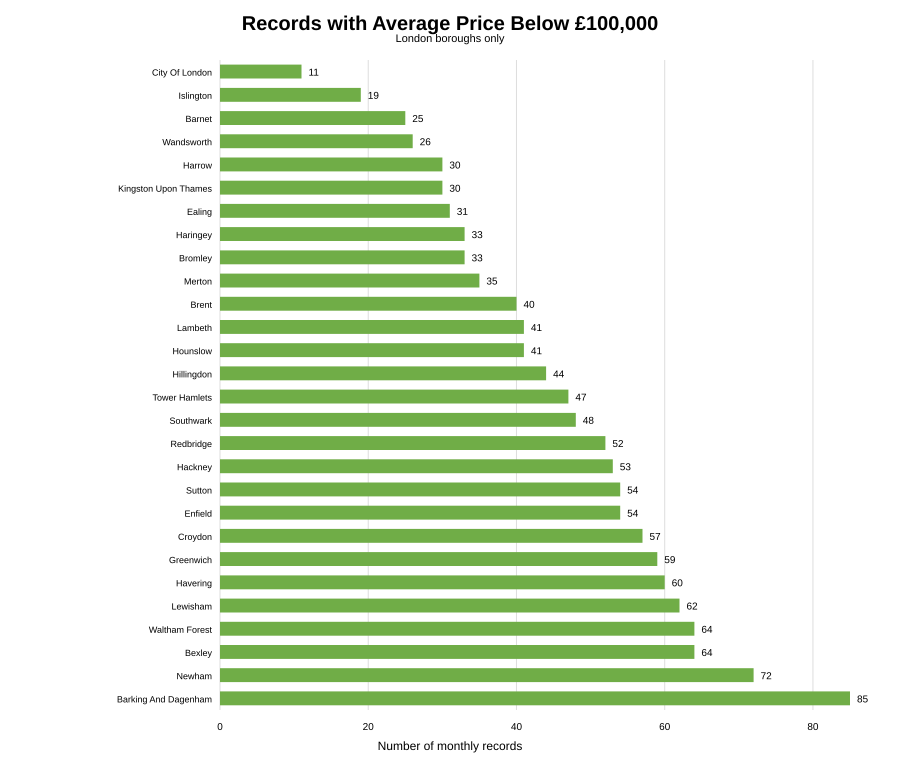

## About me

I am a CISC7204 student developing practical skills in Python data analysis and visualization. This portfolio covers data cleaning, exploratory analysis, statistical summaries, visual communication, interactive charts, and geospatial visualization.

## Technical skills

Python, pandas, NumPy, SciPy, Matplotlib, Seaborn, Bokeh, Plotly, Folium, Jupyter Notebook, grouped summaries, filtering, descriptive statistics, and reproducible project organization.

## Featured project: London Housing Prices and Crime Patterns

**Research question:** How do housing prices change over time in the England aggregate series, and how do recorded crime counts and lower-price records vary across London boroughs?

England's maximum monthly average price rose from **£53,901 in 1995** to **£250,410 in 2019**. Westminster had the highest maximum monthly crime count (**7,461**), followed by Lambeth (**4,701**) and Camden (**4,558**). The dataset contains **104 zero-crime records**, all from City of London between 2001 and 2010. Records below £100,000 were most frequent in Barking and Dagenham (**85**) and Newham (**72**). The results are descriptive and do not establish causation.

**Project status:** Completed semester analysis.

**Project repository:** [CISC7204 Data Science Project Collection](https://github.com/mc64179/data-science-project)

## Additional course work

The project repository also documents Police, Weather, Cars, and COVID-19 analyses, plus selected visualization, geospatial, interactive, and statistical reasoning notebooks from the semester. Assignment 01, Assignment 02, and Midterm materials remain separate.

## Data sources and responsible sharing

The project uses course-provided exercise copies. The London Housing file appears to correspond to the public Kaggle dataset [London Housing Data](https://www.kaggle.com/datasets/rohitgrewal/london-housing-data), but the supplied copy does not state a licence. The original provider and redistribution terms for the other course datasets were not included in the materials. The project therefore does not claim an open licence; raw-data reuse should be checked against the original providers' terms. No passwords, API keys, or private records are included.

## Feedback and improvement

Liu Yuechi (MC640935) asked for concrete numerical findings instead of a methods-only description. I added specific price, crime-count, zero-crime, and lower-price-record findings to this page, the project README, and the labelled figures. The technical review checks are implementation notes and are not attributed to Liu.
