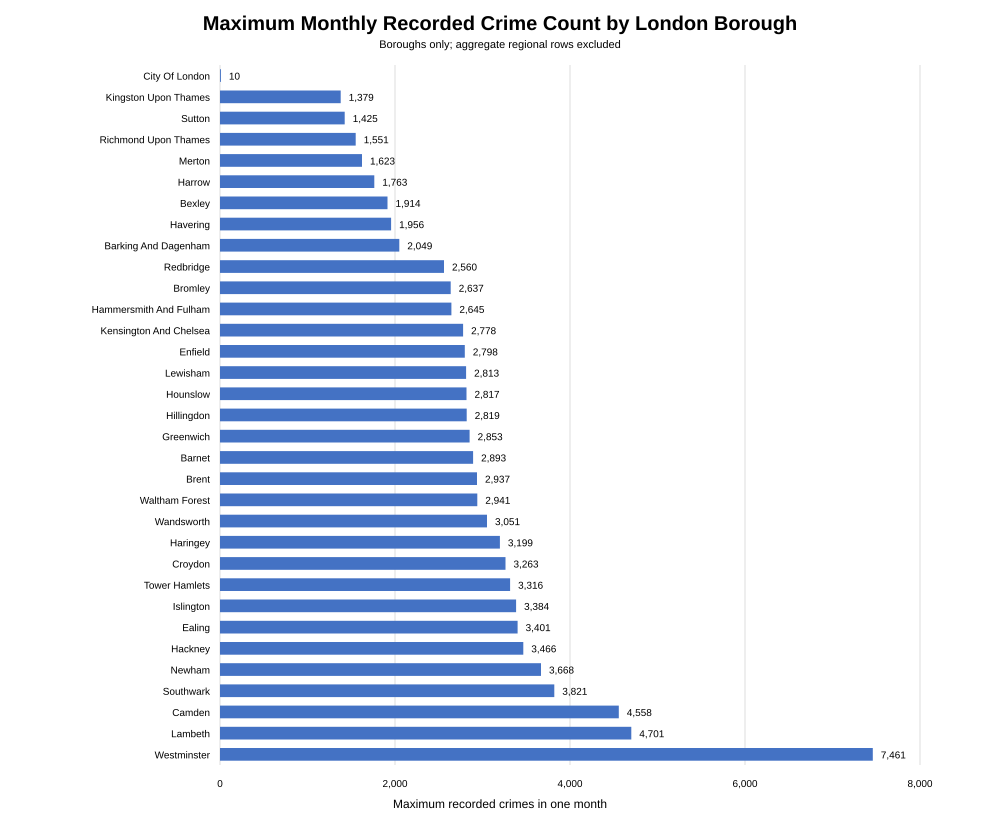

## About me

I am a CISC7204 student developing practical skills in Python data analysis and visualization. This portfolio covers data cleaning, exploratory analysis, statistical summaries, visual communication, interactive charts, and geospatial visualization.

## Technical skills

Python, pandas, NumPy, SciPy, Matplotlib, Seaborn, Bokeh, Plotly, Folium, Jupyter Notebook, grouped summaries, filtering, descriptive statistics, and reproducible project organization.

## Featured project: London Housing Prices and Crime Patterns

**Research question:** How do housing prices change over time in the England aggregate series, and how do recorded crime counts and lower-price records vary across London boroughs?

England's maximum monthly average price rose from **£53,901 in 1995** to **£250,410 in 2019**; the 2020 figure of **£247,355** comes from a single month. Westminster recorded the highest monthly crime count (**7,461**), followed by Lambeth (**4,701**) and Camden (**4,558**). The dataset contains **104 zero-crime records**, all from City of London between 2001 and 2010. Records below £100,000 were most frequent in Barking and Dagenham (**85**) and Newham (**72**).

**Limitation:** these results describe the supplied exercise sample of monthly records from 1995 to 2020. They do not show that crime causes housing prices, and they cover reported records rather than every London transaction.

*Figure 1. Lowest and highest monthly average price for England in each year, 1995-2020.*

*Figure 2. Highest monthly recorded crime count for each London borough; regional aggregate rows are excluded.*

*Figure 3. Number of monthly records with an average price below £100,000, by London borough.*

**Project status:** Completed semester analysis.

**Project repository:** [CISC7204 Data Science Project Collection](https://github.com/mc64179/data-science-project)

## Additional course work

The project repository also documents Police, Weather, Cars, and COVID-19 analyses, plus selected visualization, geospatial, interactive, and statistical reasoning notebooks from the semester. Assignment 01, Assignment 02, and Midterm materials remain separate.

## Data sources and responsible sharing

The project uses course-provided exercise copies. The London Housing file appears to correspond to the public Kaggle dataset [London Housing Data](https://www.kaggle.com/datasets/rohitgrewal/london-housing-data), but the supplied copy does not state a licence. The original provider and redistribution terms for the other course datasets were not included in the materials. The project therefore does not claim an open licence, and raw-data reuse should be checked against the original providers' terms. No passwords, API keys, or private records are included.

## Feedback and improvement

My classmate Liu Yuechi reviewed the first version of this portfolio and told me that it described methods but reported no concrete findings. In response I added the numerical results and figure captions above, rebuilt the three charts with titles, axis labels, and units, and added `plot_london_housing.py` so the figures can be regenerated from the data.

- Peer reviewer: Liu Yuechi, my classmate in CISC7204
- Feedback: "The portfolio described methods but did not report concrete numerical findings."
- Improvement commit: [`3d2c623`](https://github.com/mc64179/data-science-portfolio/commit/3d2c62332dda11b618f5a2986d7ab361156b5c45)
