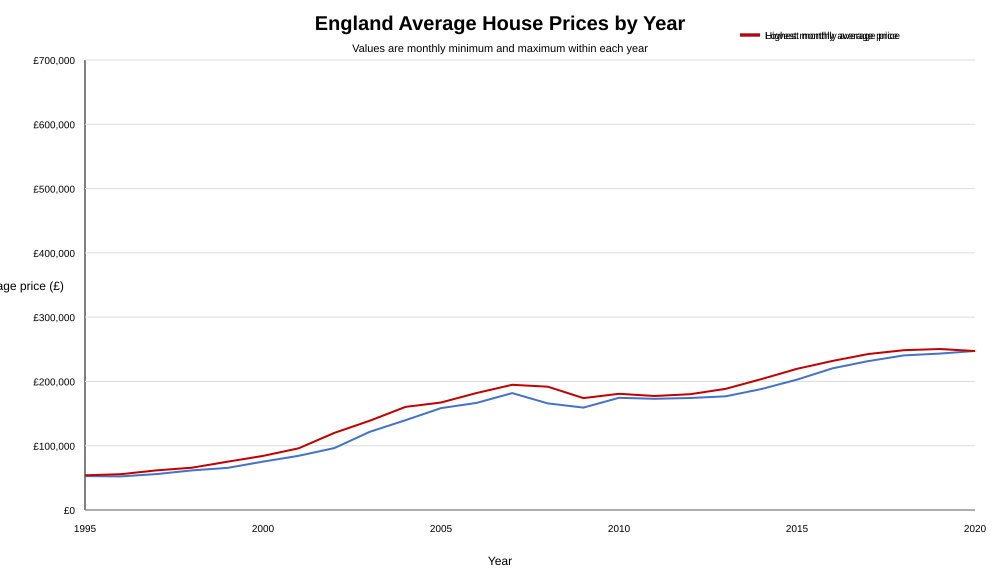
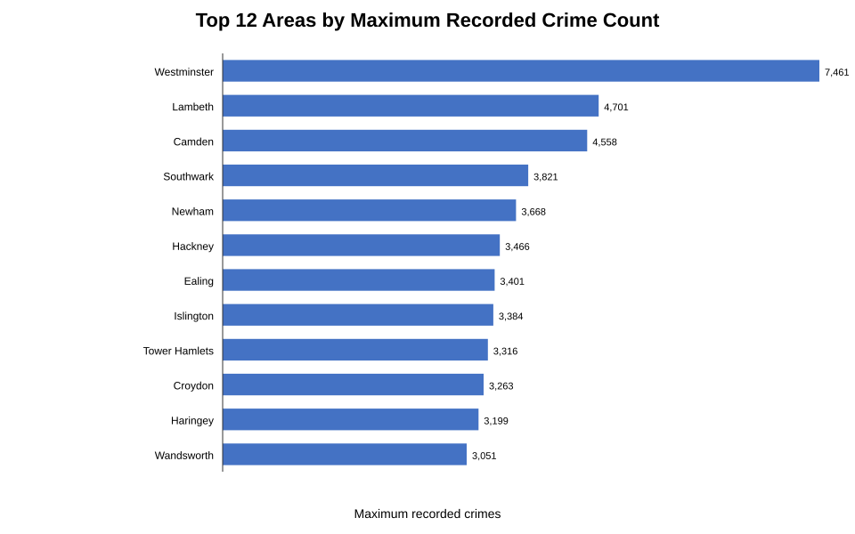

# Chen Tianying — Data Science Portfolio

## About me

I am a CISC7204 student building practical skills in Python data analysis and visualization. My work covers data cleaning, exploratory analysis, statistical summaries, visual communication, interactive charts, and geospatial visualization.

## Technical skills

- Python, pandas, NumPy, SciPy
- Matplotlib, Seaborn, Bokeh, Plotly, Folium
- Jupyter Notebook and reproducible project organization
- Data cleaning, grouped summaries, filtering, descriptive statistics, and visualization

## Featured project: London Housing Prices and Crime Patterns

**Research question:** How do average housing prices and recorded crime counts vary across years and areas in the supplied London housing dataset?

The analysis converts dates, derives year and month fields, compares yearly housing price extremes, summarizes crime counts by area, and identifies lower-priced records. The results are descriptive and cannot establish that crime causes housing prices.

**Project status:** Completed course analysis.

**Project repository:** [CISC7204 Data Science Project Collection](https://github.com/mc64179/data-science-project)

## Additional course work

The project repository also documents Police, Weather, Cars, and COVID-19 analyses, plus selected visualization, geospatial, interactive, and statistical reasoning notebooks from the semester.

## Responsible sharing

The repository contains course exercise datasets and analysis outputs. Before publication, I will verify the original data providers' licences and include required attribution. No passwords, API keys, or private records are included.

## Feedback improvement

A peer review will be recorded before final submission. The improvement commit will clarify the featured project's research question, explain the visual findings, and make the reproduction steps easier to follow.
